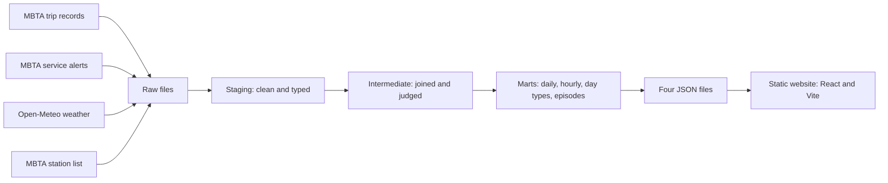

# Headway: a year of Boston subway service

A data pipeline and analysis of where, when, and why Boston's subway fell short of its schedule over a rolling year. It joins about 14.5 million train-stop records with the MBTA's service alerts and hourly weather, labels every line on every day, and publishes the result as a small interactive website.

[](https://github.com/davidnamgung/transit-ops-platform/actions/workflows/ci.yml)

**Status.** The pipeline, tests, analysis, and website are built and working. Scheduled automation, a live site, and a platform-health page are in progress. There is **no forecasting model yet**; every number is a measurement of something that already happened.

## What it does

- **Collects** the MBTA's train records (one file per service day), its service-alert history, hourly Boston weather, and station locations.
- **Cleans and joins** them in a layered DuckDB warehouse (staging, intermediate, marts: 12 tables), rebuilt from scratch on every run in about a minute.
- **Labels** each line on each day as normal, planned closure, disruption, or schedule gap, then checks those labels against the MBTA's own alerts.
- **Publishes** four small JSON files that a static React site reads in the browser: a story of the year, a calendar explorer, per-line pages, an episodes table, a weather grid, a full report, and a method document.

## How it fits together



## Run it yourself

You need [uv](https://docs.astral.sh/uv/) for Python and Node.js 22.12 or newer. A free [MBTA API key](https://api-v3.mbta.com/) is optional; the pipeline works without it at a lower rate limit.

```bash
git clone https://github.com/davidnamgung/transit-ops-platform.git
cd transit-ops-platform
uv sync
echo "MBTA_API_KEY=your-key-here" > .env       # optional

uv run python pipeline/run.py                   # download, build, check, export
                                                # (the first run downloads about 800 MB)
cd app
npm install
npm run sync-data                               # copies the exported files into the site
npm run dev                                     # opens the site locally
```

`pipeline/run.py` stops at the first failed download or build, runs every data-quality check, skips the export if any check failed, and writes a record of the run to `exports/pipeline_run.json`. Useful options: `--skip-download` to reuse the raw files on disk, and `--only download|build|check|export` to run one group.

## Tests and checks

```bash
uv run pytest          # 42 tests on a small fake data set, in about 10 seconds
uv run ruff check .    # lint
```

The tests build the warehouse from a tiny, fully known fake data set that contains every oddity found in the real data (non-passenger trips, duplicate records on the shared Green Line trunk, alerts stored in versions, an empty file, a train after midnight) and check the exact answers. The same checks and a build of the website run on every push through GitHub Actions.

Separate data-quality checks in `checks/` run against the real data as part of every pipeline run.

## Project layout

| Path | What it holds |
| --- | --- |
| `ingestion/` | Download scripts for each source; the numbered scripts 00 to 02 were exploration, 03 to 07 are the production downloads |
| `models/` | The SQL, in three layers: `staging/`, `intermediate/`, `marts/` |
| `transform/` | `build_staging.py` runs the models in order; `export_for_app.py` writes the website's data |
| `checks/` | Data-quality checks and the reproducibility fingerprint |
| `pipeline/` | `run.py`, the one command that runs everything and records how it went |
| `tests/` | The fake data set and the tests |
| `app/` | The website (React, Vite); its README covers the pages and design |
| `notebooks/` | The exploratory analysis that led to each design decision |
| `docs/` | Metric definitions |

## Decisions worth reading about

The site's Method page and `app/src/pages/Method.jsx` document twelve things that were wrong, odd, or ambiguous in the raw data, how each was found, and what was done. A few of them:

- **Non-passenger trips** looked like trains running 9 to 18 hours early and were distorting the schedule comparison. They now have their own trip kind and are excluded.
- **Nearly half of all trips are tagged ADDED**, meaning they match no published timetable trip. They are kept, but excluded from timetable comparison.
- **The newest version of every alert is a closing record** with no start or end time, so each alert is rebuilt from all of its versions.
- **The headline measure is the share of gaps between trains that run long**, because it does not need trips to match the timetable, and the timetable-based measure breaks down on the days that matter most.
- **Results are reproducible**: a fingerprint of checksums after each build proves nothing changed between runs.

## Not built yet

Scheduled automation on GitHub, the platform-health page, forecasting, and per-station reliability. The report describes the plan for forecasting, including the baseline it has to beat, but no model exists.

## Data and license

The code is released under the MIT License (see `LICENSE`). The data keeps its own terms:

- Train performance and alert data: Massachusetts Bay Transportation Authority, used under the MassDOT Developers License Agreement.
- Weather: [Open-Meteo.com](https://open-meteo.com/), see their terms for attribution and use.

This project is independent and is not affiliated with or endorsed by the MBTA.
