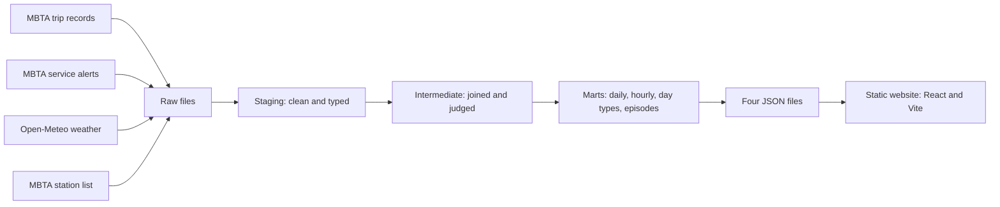
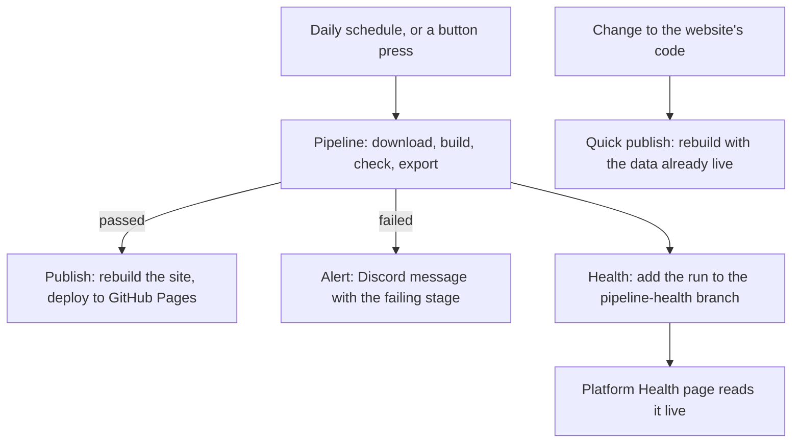

# Headway: a year of Boston subway service

**[See the live site](https://davidnamgung.github.io/transit-ops-platform/)**

A data pipeline, an analysis, and a website that together answer one question: **where, when, and why did Boston's subway fall short of its schedule over the past year?** It joins about 14.5 million train-stop records with the MBTA's service alerts and hourly weather, labels every line on every day, and republishes itself every morning.

[](https://github.com/davidnamgung/transit-ops-platform/actions/workflows/ci.yml)
[](https://github.com/davidnamgung/transit-ops-platform/actions/workflows/pipeline.yml)

The site has a [story of the year](https://davidnamgung.github.io/transit-ops-platform/#/), a [calendar explorer](https://davidnamgung.github.io/transit-ops-platform/#/explore), a [full report](https://davidnamgung.github.io/transit-ops-platform/#/report), a [method document](https://davidnamgung.github.io/transit-ops-platform/#/method), and a [Platform Health page](https://davidnamgung.github.io/transit-ops-platform/#/health) showing whether the pipeline is running right now.

**Status.** Built and running: the pipeline, 92 tests, CI, daily automation, Discord alerts, a public health page, and publishing on GitHub Pages. **Not built:** a forecasting model (every number here is a measurement of something that already happened), per-station reliability, and a migration to dbt.

## What it does

- **Collects** the MBTA's train records (one file per service day), its service-alert history, hourly Boston weather, and station locations.
- **Cleans and joins** them in a layered DuckDB warehouse (staging, intermediate, marts: 12 tables), rebuilt from scratch on every run.
- **Labels** each line on each day as normal, planned closure, disruption, or schedule gap, then checks those labels against the MBTA's own alerts.
- **Runs itself.** Every morning GitHub's free computers download the newest data, rebuild, run the data-quality checks, and publish the site. If anything fails, a Discord message arrives, the previous site stays online, and the failure appears on the Health page.

## How it fits together



And the automation around it:



## Things worth knowing

- **Deterministic.** For the same data, the daily and hourly tables produced identical checksums on a Mac (ARM processor, 8 threads) and on Linux (x86, 1 thread), both on DuckDB 2.0.0. `checks/09_machine_fingerprint.py` prints them.
- **Fast when warm.** GitHub keeps the 650 MB of downloaded trip files between runs: a run from nothing took 276 seconds; a normal run takes about a minute.
- **Fails safely.** A run that fails any check publishes nothing, so bad numbers never reach the site.
- **Tested the way you test a smoke alarm.** The 92 tests were checked by deliberately breaking the code in more than forty ways and confirming a test fails each time. That process found and fixed several weak tests.
- **Honest about its limits.** The Report lists what the data cannot tell us, and notes where a pattern is better read as a data artifact than a finding (for example, an overnight spike in long gaps that rests on a few hundred observations out of 1.3 million).

## Run it yourself

You need [uv](https://docs.astral.sh/uv/) for Python and Node.js 22.12 or newer. A free [MBTA API key](https://api-v3.mbta.com/) is optional; the pipeline works without it at a lower rate limit.

```bash
git clone https://github.com/davidnamgung/transit-ops-platform.git
cd transit-ops-platform
uv sync
echo "MBTA_API_KEY=your-key-here" > .env       # optional

uv run python pipeline/run.py                   # download, build, check, export
                                                # (the first run downloads about 800 MB)
cd app
npm install
npm run sync-data                               # copies the exported files into the site
npm run dev                                     # opens the site locally
```

`pipeline/run.py` stops at the first failed download or build, runs every data-quality check, skips the export if any check failed, and writes a record of the run to `exports/pipeline_run.json`. Useful options: `--skip-download` to reuse the raw files on disk, and `--only download|build|check|export` to run one group.

## Tests and checks

```bash
uv run pytest          # 92 tests on a small fake data set and fake servers, in about 30 seconds
uv run ruff check .    # lint
```

The tests build the warehouse from a tiny, fully known fake data set that contains every oddity found in the real data (non-passenger trips, duplicate records on the shared Green Line trunk, alerts stored in versions, an empty file, a train after midnight) and check the exact answers. Other tests run the downloader, the orchestrator, the alert sender, and the publishing scripts against small web servers and git repositories on the test machine, so nothing real is ever contacted. CI runs all of it, plus a build of the website, on every push.

Separate data-quality checks in `checks/` run against the real data on every pipeline run.

## Project layout

| Path | What it holds |
| --- | --- |
| `ingestion/` | Download scripts; 00 to 02 were exploration, 03 to 07 are the production downloads |
| `models/` | The SQL, in three layers: `staging/`, `intermediate/`, `marts/` |
| `transform/` | `build_staging.py` runs the models in order; `export_for_app.py` writes the website's data |
| `checks/` | Data-quality checks and the reproducibility fingerprints |
| `pipeline/` | `run.py` runs everything and records how it went; `notify.py`, `health.py`, `publish_health.sh`, and `fetch_live_data.py` handle alerts, the run history, and publishing |
| `tests/` | The fake data set and the tests |
| `app/` | The website (React, Vite); its README covers the pages and design |
| `docs/` | Metric definitions, the [runbook](docs/runbook.md), and a [postmortem template](docs/postmortem-template.md) |
| `.github/workflows/` | `ci.yml` (tests on every push), `pipeline.yml` (the daily run), `site.yml` (quick publish for website changes) |

## Decisions worth reading about

The site's Method page documents twelve things that were wrong, odd, or ambiguous in the raw data, how each was found, and what was done. A few of them:

- **Non-passenger trips** looked like trains running 9 to 18 hours early and were distorting the schedule comparison. They now have their own trip kind and are excluded.
- **Nearly half of all trips are tagged ADDED**, meaning they match no published timetable trip. They are kept, but excluded from timetable comparison.
- **The newest version of every alert is a closing record** with no start or end time, so each alert is rebuilt from all of its versions.
- **The headline measure is the share of gaps between trains that run long**, because it does not need trips to match the timetable, and the timetable-based measure breaks down on the days that matter most.

## Operating it

The [runbook](docs/runbook.md) covers every alert and failure. A "Practice run" button on the Pipeline workflow fails the pipeline on purpose, so you can see an alert, a red Health square, and the recovery before a real failure happens.

## Data and license

The code is released under the MIT License (see `LICENSE`). The data keeps its own terms:

- Train performance and alert data: Massachusetts Bay Transportation Authority, used under the MassDOT Developers License Agreement.
- Weather: [Open-Meteo.com](https://open-meteo.com/), see their terms for attribution and use.

This project is independent and is not affiliated with or endorsed by the MBTA.
