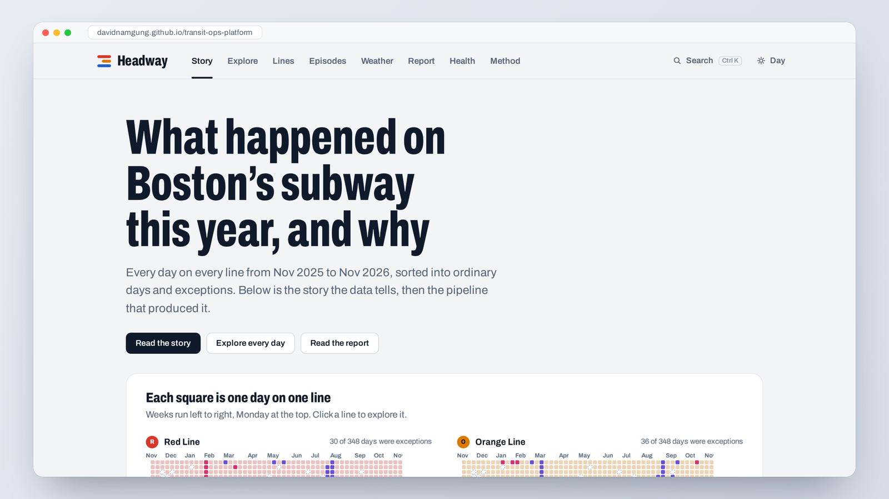
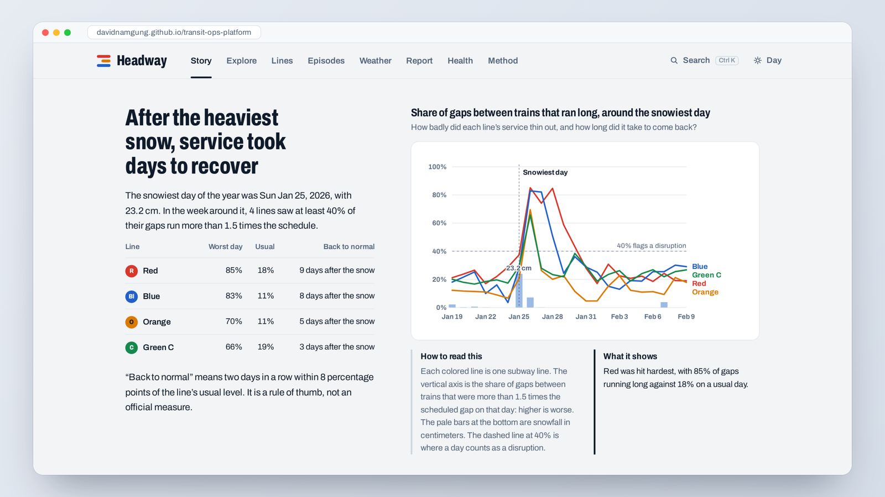
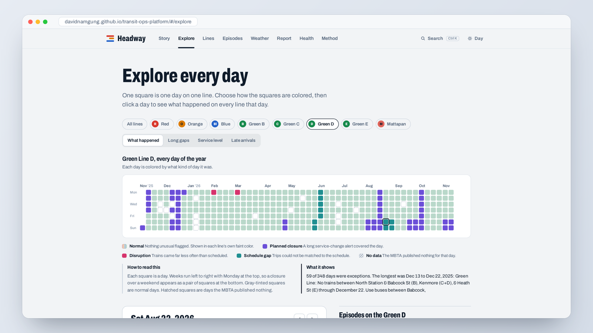
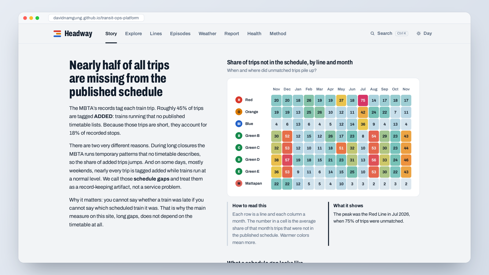
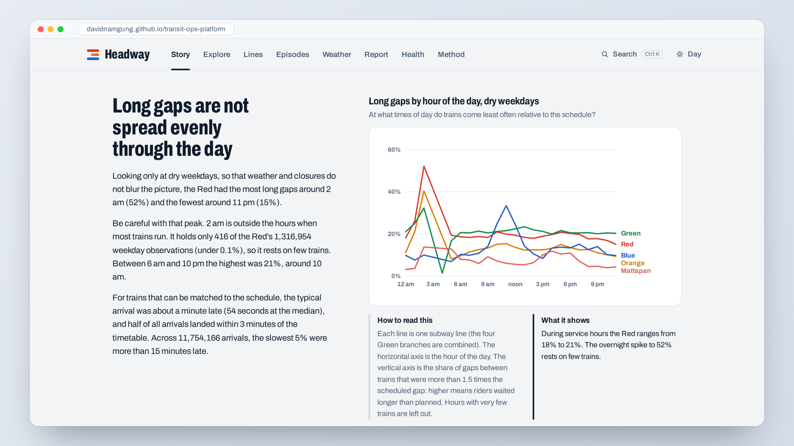
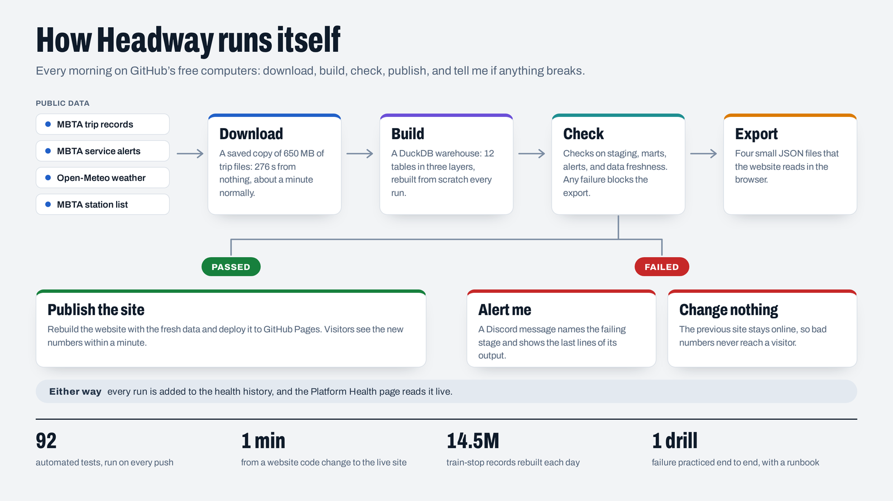

<p align="center">
  <a href="https://davidnamgung.github.io/transit-ops-platform/"></a>
</p>

# Headway: a year of Boston subway service

**A data pipeline, an analysis, and a website that answer one question: where, when, and why did Boston's subway fall short of its schedule? It rebuilds and republishes itself every morning.**

**[Open the live site](https://davidnamgung.github.io/transit-ops-platform/)** · [The story](https://davidnamgung.github.io/transit-ops-platform/#/) · [The full report](https://davidnamgung.github.io/transit-ops-platform/#/report) · [How it was built](https://davidnamgung.github.io/transit-ops-platform/#/method) · [Is the pipeline healthy right now?](https://davidnamgung.github.io/transit-ops-platform/#/health)

[](https://github.com/davidnamgung/transit-ops-platform/actions/workflows/ci.yml)
[](https://github.com/davidnamgung/transit-ops-platform/actions/workflows/pipeline.yml)

## The short version

- **The data.** About 14.5 million train-stop records from the MBTA, joined with its service alerts and hourly weather, covering a rolling year.
- **The analysis.** Every line on every day is labeled as normal, a planned closure, a disruption, or a schedule gap, and those labels are checked against the MBTA's own alerts.
- **The engineering.** A daily pipeline on free GitHub servers downloads, rebuilds, checks, and publishes the site. If anything fails, I get a Discord message, the previous site stays online, and the failure shows on a public health page.

## What the data says

*From the November 2026 build. The live site always shows the current year.*

- **Most days were ordinary:** about 88% of line-days had nothing unusual.
- **Planned work is the biggest exception.** The longest closure was the Orange Line's Oak Grove to Back Bay suspension, August 20 to 30, 2026 (11 days). The MBTA's alerts agree with the train data about which days were closures: 88% of days when most trips were missing from the timetable fall inside a long service-change alert, against 5.5% of normal days.
- **Snow breaks service, and recovery outlasts the storm.** On January 25, 2026 (23.2 cm), four lines crossed the 40% long-gap threshold. The Red Line peaked at 85% and took 9 days to return to its usual range.
- **Nearly half of all trips are missing from the published schedule** (18% of recorded stops, because those trips are short). So the main measure here, the share of gaps between trains that run long, deliberately does not depend on matching trains to the timetable.
- **Snow hours had 25% long gaps against 17% when dry**, with the caution, stated on the site, that snow also brings its own season, schedules, and closures, so this describes a pattern and does not prove a cause.

I also tried to be honest about where the data misleads. The daily-rhythm chart has a large overnight spike that, on inspection, rests on 416 observations out of 1.3 million. The site says so instead of presenting it as a finding.

<table>
  <tr>
    <td width="50%"><a href="https://davidnamgung.github.io/transit-ops-platform/#/"></a><br><sub><b>Snow and recovery.</b> Every chart states its point, says how to read it, and says what it shows.</sub></td>
    <td width="50%"><a href="https://davidnamgung.github.io/transit-ops-platform/#/explore"></a><br><sub><b>Explore every day.</b> One square per day, so a weekend closure shows up as a pair of squares.</sub></td>
  </tr>
  <tr>
    <td width="50%"><a href="https://davidnamgung.github.io/transit-ops-platform/#/"></a><br><sub><b>Trips outside the schedule.</b> Where and when unmatched trips piled up.</sub></td>
    <td width="50%"><a href="https://davidnamgung.github.io/transit-ops-platform/#/"></a><br><sub><b>A normal day.</b> Including the caution about the overnight spike.</sub></td>
  </tr>
</table>

## More than an analysis

<p align="center"></p>

- **It runs itself.** A schedule on GitHub's free computers does everything every morning. Saved downloads make a normal run take about a minute, against 276 seconds from nothing.
- **It fails safely.** A run that fails any check publishes nothing, so bad numbers never reach the site.
- **It is tested like a smoke alarm.** 92 tests run on every push, and I verified the tests by deliberately breaking the code in more than forty ways and confirming a test fails each time. That found and fixed several tests that would have passed anyway.
- **It is observable.** Discord alerts, a public [Platform Health page](https://davidnamgung.github.io/transit-ops-platform/#/health) fed by a run history, a [runbook](docs/runbook.md), and a failure drill I ran end to end.
- **It is reproducible.** For the same data, the daily and hourly tables produced identical checksums on a Mac (ARM, 8 threads) and on Linux (x86, 1 thread).
- **It is hardened.** One run at a time, time limits, least-privilege permissions per job, every outside action pinned to an exact commit, and Dependabot proposing updates after a two-week wait.

## Built with

Python · SQL · DuckDB · pytest · ruff · GitHub Actions · GitHub Pages · React · Vite · D3 (scales and shapes)

<details>
<summary><b>Run it yourself</b></summary>

You need [uv](https://docs.astral.sh/uv/) for Python and Node.js 22.12 or newer. A free [MBTA API key](https://api-v3.mbta.com/) is optional; the pipeline works without it at a lower rate limit.

```bash
git clone https://github.com/davidnamgung/transit-ops-platform.git
cd transit-ops-platform
uv sync
echo "MBTA_API_KEY=your-key-here" > .env       # optional

uv run python pipeline/run.py                   # download, build, check, export
                                                # (the first run downloads about 800 MB)
cd app
npm install
npm run sync-data                               # copies the exported files into the site
npm run dev                                     # opens the site locally
```

`pipeline/run.py` stops at the first failed download or build, runs every data-quality check, skips the export if any check failed, and writes a record of the run to `exports/pipeline_run.json`. Useful options: `--skip-download` to reuse the raw files on disk, and `--only download|build|check|export` to run one group.

```bash
uv run pytest          # 92 tests, about 30 seconds
uv run ruff check .    # lint
```

</details>

<details>
<summary><b>Project layout</b></summary>

| Path | What it holds |
| --- | --- |
| `ingestion/` | Download scripts; 00 to 02 were exploration, 03 to 07 are the production downloads |
| `models/` | The SQL, in three layers: `staging/`, `intermediate/`, `marts/` |
| `transform/` | `build_staging.py` runs the models in order; `export_for_app.py` writes the website's data |
| `checks/` | Data-quality checks and the reproducibility fingerprints |
| `pipeline/` | `run.py` runs everything; `notify.py`, `health.py`, `publish_health.sh`, and `fetch_live_data.py` handle alerts, the run history, and publishing |
| `tests/` | The fake data set and the tests |
| `app/` | The website (React, Vite) |
| `docs/` | Metric definitions, the [runbook](docs/runbook.md), and a [postmortem template](docs/postmortem-template.md) |
| `.github/workflows/` | `ci.yml` (tests on every push), `pipeline.yml` (the daily run), `site.yml` (quick publish for website changes) |

The tests build the warehouse from a tiny, fully known fake data set that contains every oddity found in the real data (non-passenger trips, duplicate records on the shared Green Line trunk, alerts stored in versions, an empty file, a train after midnight) and check the exact answers. Other tests run the downloader, the orchestrator, the alert sender, and the publishing scripts against small web servers and git repositories on the test machine, so nothing real is ever contacted.

</details>

<details>
<summary><b>Decisions worth reading about</b></summary>

The site's [Method page](https://davidnamgung.github.io/transit-ops-platform/#/method) documents twelve things that were wrong, odd, or ambiguous in the raw data, how each was found, and what was done. A few of them:

- **Non-passenger trips** looked like trains running 9 to 18 hours early and were distorting the schedule comparison. They now have their own trip kind and are excluded.
- **Nearly half of all trips are tagged ADDED**, meaning they match no published timetable trip. They are kept, but excluded from timetable comparison.
- **The newest version of every alert is a closing record** with no start or end time, so each alert is rebuilt from all of its versions.
- **The headline measure is the share of gaps between trains that run long**, because it does not need trips to match the timetable, and the timetable-based measure breaks down on the days that matter most.

</details>

## Limits, and what is next

- **Not built:** a forecasting model (every number here measures something that already happened; the Report describes the plan, including the baseline a model would have to beat), per-station reliability, and a move to dbt.
- **The data cannot say why a disruption happened,** what riders experienced, or whether a closure was announced in advance. The Report lists these limits in full.

## Data and license

The code is released under the MIT License (see `LICENSE`). The data keeps its own terms:

- Train performance and alert data: Massachusetts Bay Transportation Authority, used under the MassDOT Developers License Agreement.
- Weather: [Open-Meteo.com](https://open-meteo.com/), see their terms for attribution and use.

This project is independent and is not affiliated with or endorsed by the MBTA.
